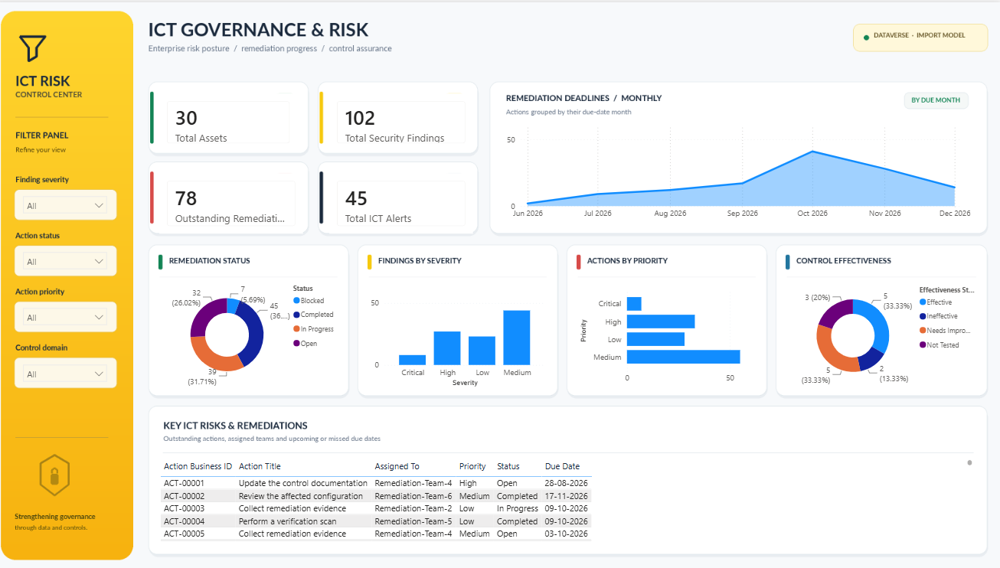

# ICT Governance & Risk Automation Platform

**An end-to-end ICT governance prototype built with Microsoft Power Platform, Python, and Power BI.**

This project demonstrates how a governance team can organize ICT assets and controls, track security findings and remediation actions, generate operational alerts, and prioritize risks using an **explainable, rules-based scoring model**. It was developed using **synthetic demonstration data**.

> **Project status:** Functional prototype. The Python scoring model, Dataverse synchronization, two automation flows, Power Apps interface, and Power BI reporting have been tested. This is a portfolio demonstration, not a production-ready risk management system.

## Dashboard preview



The Power BI report contains **six pages**: ICT Risk Dashboard, Executive Metrics, Risk & Security Findings, Remediation Tracking, ICT Controls & Alerts, and Risk Intelligence & Prioritization. The executive page uses a custom-designed background with interactive Power BI visuals overlaid; the Risk Intelligence page uses native data visuals.

## What it does

| Component | Function |
| --- | --- |
| **Dataverse** | Stores ICT assets, controls, findings, remediation actions, alerts, and risk assessments in six tables. |
| **Power Apps** | Provides a model-driven app for viewing and managing records across six sections. |
| **Power Automate** | Creates alerts for critical findings and overdue remediation actions, with duplicate-prevention logic tested. |
| **Python** | Validates input records, calculates finding-level risk scores, generates explanations and recommendations, and synchronizes the results to Dataverse. |
| **Power BI** | Provides executive reporting, remediation monitoring, and interactive risk-prioritization analysis. |

### High-level architecture

```text
Synthetic CSV data (4 input datasets)
            |
            v
    Python validation and
    explainable risk scoring
            |
            +----> data/processed/risk_scores.csv
            |                   |
            v                   v
      Microsoft Dataverse (6 tables)
            |                 |
            v                 v
      Power Apps         Power Automate
      operations         alert workflows
            |
            v
      Power BI reporting
  (Dataverse data + risk assessments)
```

The import/synchronization components use Dataverse APIs. The Power BI reporting model reads Dataverse data; the additional risk assessment query uses the Dataverse OData endpoint.

## Demonstrated results

The following figures reflect the **October 18, 2026 synthetic-data demonstration**, not live organizational risk.

| Result | Value |
| --- | ---: |
| Assets | 30 |
| ICT controls | 15 |
| Source security findings scored | 100 |
| Remediation actions | 123 |
| Risk assessment records synchronized to Dataverse | 100 |
| Automated Python tests passed | 13/13 |
| Critical risk scores | 9 |
| High risk scores | 32 |
| Medium risk scores | 51 |
| Low risk scores | 8 |
| P1 immediate reviews (active) | 7 |
| Active high/critical review cases | 35 |
| Historical closure-verification cases | 23 |

**Data scope note:** Two security findings were created directly in Dataverse for workflow tests, resulting in 102 findings in some operational views. The risk-scoring run used the 100 findings in the local CSV dataset, so the Risk Intelligence page reports 100 assessments.

## Explainable risk scoring

The Python model computes a weighted score on a 0–100 scale:

| Factor | Maximum points |
| --- | ---: |
| Finding severity | 40 |
| Asset criticality | 20 |
| ICT control effectiveness | 15 |
| Remediation status and overdue deadlines | 15 |
| Internet exposure | 10 |
| **Total** | **100** |

Risk categories: **Critical (80–100)**, **High (60–79)**, **Medium (40–59)** and **Low (0–39)**. Individual factor contributions are included in the `risk_explanation` output.

The model distinguishes **risk score** from **review priority**. Closed or resolved findings retain their underlying risk score but are labeled `Historical - verify closure` instead of automatically being assigned an active P1–P4 work priority. Recommendations are generated with deterministic rules and should be reviewed by a person.

**Important:** This implementation is a **rules-based decision-support engine**, not a trained machine learning model or a generative AI application. Its weights and recommendations are illustrative and would require domain review, calibration, and governance approval in any real deployment.

## Technology stack

- Python and standard-library `csv`, `argparse`, `datetime`, and `unittest`
- `requests` and `msal` for Dataverse API integration
- Microsoft Dataverse
- Power Apps (model-driven app)
- Power Automate (cloud flows)
- Power BI Desktop (report in `.pbix` and/or project in `.pbip` format)
- VS Code and Git

## Run the risk scoring locally

The scripts expect the following input data files in `data/raw/`:

```text
assets.csv
ict_controls.csv
security_findings.csv
remediation_actions.csv
```

1. Create and activate a Python virtual environment if not already present.
2. Install Dataverse integration dependencies if needed:

   ```powershell
   python -m pip install requests msal
   ```

3. Score findings against the demonstrated assessment date:

   ```powershell
   python -m src.risk_scoring --as-of 2026-10-18
   ```

   Output: `data/processed/risk_scores.csv`.

4. Run automated checks:

   ```powershell
   python -m unittest discover -s tests -v
   ```

5. When using an **authorized Dataverse development environment** with the six-table schema already configured, preview synchronization **without writing data**:

   ```powershell
   python -m src.sync_risk_assessments --table ict_ictriskassessment
   ```

   After checking the planned records and obtaining authorization to update the target environment, run with `--apply`. This can create or update Dataverse records. The provided Python integration was configured for a specific development tenant and may require adapting its organization URL, app registration, and authentication settings for reuse elsewhere.

> **Prerequisite:** The Dataverse table schema, app, flows, and Power BI connector permissions must exist in the target environment. The local Python commands alone do not provision the entire Microsoft Power Platform solution. Do not publish tenant-specific endpoints, cached credentials, or access tokens without reviewing them first.

## Repository guidance

The project uses an editable Power BI project (`.pbip`) during development and a `.pbix` deliverable for demonstration. Power BI Desktop may generate temporary `.pbi` cache folders; these should not be committed. Exported solutions, scripts, and non-sensitive synthetic sample data may be version controlled after review.

Before publishing a repository, verify that it contains **no tenant secrets, client secrets, token caches, sensitive endpoints, non-synthetic organizational records, or private personal information**. Check Power Query source definitions and Power Platform solution exports, not just Python files.

## Limitations and next steps

- Findings scored locally: 100; Dataverse test-only findings are intentionally outside the current scoring CSV.
- The scoring weights are illustrative and were not benchmarked against a regulatory framework.
- The assessment table currently represents a current snapshot per finding, not a full audit history.
- An alternate key or upsert strategy should be configured for stronger concurrency-safe duplicate prevention.
- Additional production hardening would include role-based access control, monitoring, audit logs, deployment automation, and model/weight governance.
- Optional language-model-based narratives are **not** part of the implemented prototype.

## Portfolio takeaway

This project demonstrates practical ICT governance workflows, relational data modeling, low-code automation, Python-based risk prioritization, API integration, analytical reporting, test-driven validation, and the ability to separate automated recommendations from human governance decisions.
